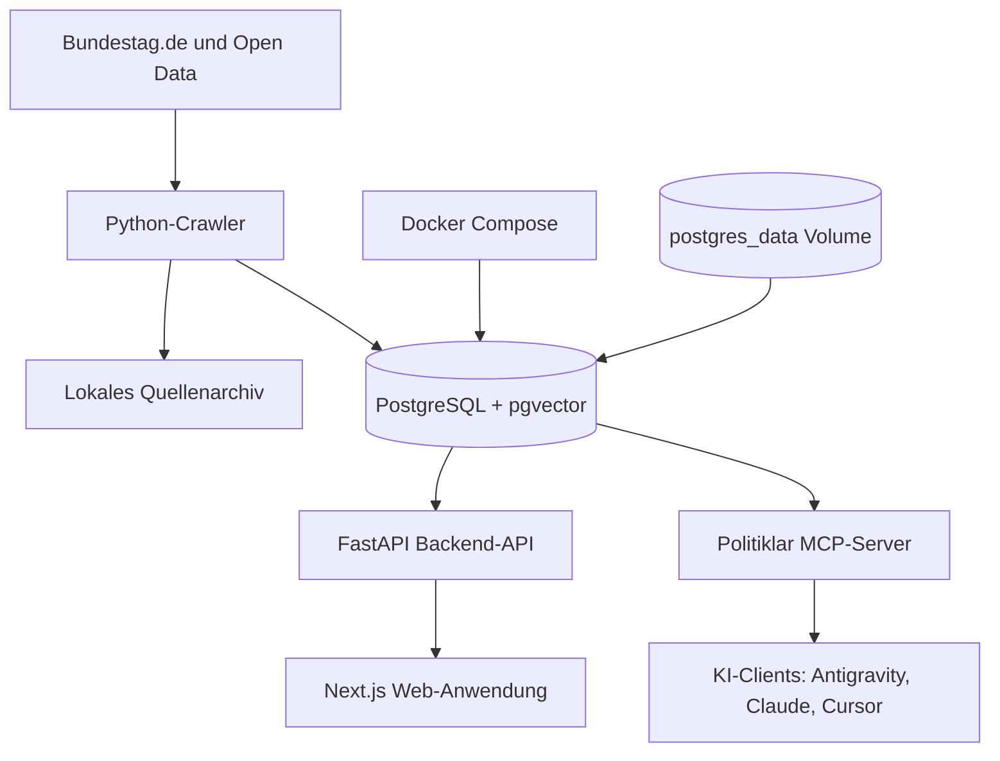

# Aktuelle Architektur

## Implementiert

- PostgreSQL 17 mit pgvector in Docker Compose
- Persistentes `postgres_data`-Volume
- Python-Crawler mit HTTP-Provenienz und Quellenarchiv
- Alembic-Migrationen und relationales SQLAlchemy-2.0-Datenmodell
- Importer fuer Bundestag-Biografien, namentliche Abstimmungen und Plenarprotokolle
- FastAPI Backend-API (`apps/backend/src/api/`) mit OpenAPI-Dokumentation (`/docs`), Healthchecks, Quellenprovenienz, Abgeordneten-, Abstimmungs- und Reden-Endpunkten
- RAG- und Vektordaten-Pipeline (pgvector HNSW-Index, modularer `AIProvider` fuer Gemini/OpenAI, LangChain Chunker, siehe [rag-architecture.md](rag-architecture.md))
- Politiklar Model Context Protocol (MCP) Server (`apps/backend/src/mcp_server/`) mit Stdio- und SSE-Transport, Token-Authentifizierung und 5 Tools (siehe [mcp-server.md](mcp-server.md))
- Next.js Web-Anwendung (`apps/web/`) mit interaktivem Politiker-Chatbot und API-Schlüsselverwaltung unter `/konto`

## Noch geplant

- Vollstaendige automatische Mitgliederdiscovery
- Drucksachenimport mit konfiguriertem DIP-API-Key
- Verifizierte automatische Zuordnung historischer Abstimmungs- und Redezeilen zur MDB-ID
- Ingestion-Job zur Einbettung historischer Reden und Dokumente

Zurueck zur [Dokumentationsuebersicht](README.md).